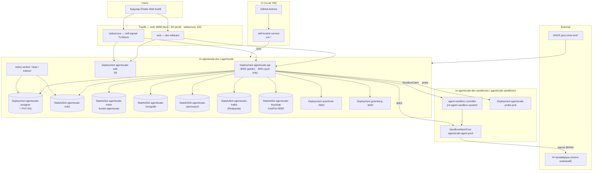

# Topology инфраструктуры (as-built)

Физическая и логическая топология **Agentscale**: от UI в браузере до Pod'ов проектов
в k3s. Всё, что ниже, сверено с `infra/k3s/`, `infra/argocd/` и `.github/workflows/`.

Топология, которая была здесь раньше (`prodavan-api`, `prodavan-ws`, `mcp-gateway`,
неймспейсы `prodavan*`, `ingress-nginx`, staging-кластер), в кластере не существует —
таблица соответствий в разделе «Отличия от прежней схемы».

---

## High-level diagram



---

## Network zones

| Zone | Components | Exposure |
|------|------------|----------|
| **Public** | Traefik `websecure` (:443) — prod wildcard; `web` (dev :8088, prod :80) | интернет/туннель для :443; dev :8088 — только с VM |
| **App** | `agentscale-api` (:8000, :8001), `agentscale-web` (:80) | через ingress (:8000) и из sandbox-неймспейса (:8001) |
| **Platform** | postgres, redis, minio, mongodb, opensearch, kafka, keycloak, searchnet, gotenberg, celery | только in-cluster DNS |
| **Sandbox** | Pod'ы проектов (`agentscale-*-sandboxes`) | egress-allowlist (NetworkPolicy) |
| **CI** | self-hosted раннеры на той же VM | kubeconfig `/home/runner/.kube/prodavan-dev.yaml` |

Сеть — плоская k3s (pod CIDR `10.42.0.0/16`, service CIDR `10.43.0.0/16`); Pod'ы
проектов **не** видят ни один сервис платформы, кроме `:8001` в ns приложения
(`NetworkPolicy agentscale-sandboxes-egress`).

---

## Traffic flows

### UI / REST API

```text
Браузер → Traefik (:8088 dev / :80 prod / :443, /api, /health) → agentscale-api:8000
        → PostgreSQL / Redis / MinIO / MongoDB / OpenSearch / Kafka
```

Путь `/` отдаёт `agentscale-web:80` — nginx с собранным Flutter Web; он же проксирует
`/api` и `/health` на `agentscale-api:8000`, поэтому NodePort `:30090` в prod отдаёт
всё приложение одним origin.

### Agent runtime / Pod проекта

```text
agentscale-api (:8000)
  → SandboxClaim (CR, ns agentscale-*-sandboxes)
    → agent-sandbox controller → Pod из SandboxTemplate agentscale-agent
      → agent-runtime :3921 (prodavan-agent-runtime, пин 58211a516231)
        → agentscale-api:8001 (Pod Identity Bridge: события, web.search, hydrate)
        → AI-провайдеры по 443 (ключи компаний)
```

Файловый/командный канал идёт через sandbox router (`agent-sandbox-system`), не через
`pods/exec` — RBAC API его не выдаёт.

### Web search

```text
agent-runtime → agentscale-api:8001 /web-fetch, /search-прокси
             → searchnet:3950 (рендер через camoufox/chromium, обход антибот-щитов)
```

Прямого доступа из sandbox-неймспейса в `searchnet` нет: `NetworkPolicy` разрешает
только `:8001`.

### Auth

Keycloak — не ingress-маршрут, а hostPort на той же VM (`:8089` dev, `:8099` prod).
Issuer — `http://127.0.0.1:<port>/realms/agentscale`; JWKS API тянет по in-cluster
адресу `agentscale-keycloak:8080`.

---

## Namespaces (k3s)

| Namespace | Что там | Кто создаёт |
|-----------|---------|-------------|
| `agentscale-dev` | api, web, celery ×3, postgres, redis, minio, mongodb, opensearch, kafka, keycloak, searchnet, gotenberg | Argo `agentscale-dev` (ветка `main`) |
| `agentscale` | то же для prod, образы запинены SHA | Argo `agentscale-prod` (ветка `prod`) |
| `agentscale-dev-sandboxes` | SandboxWarmPool, SandboxClaim'ы, `agentscale-probe-pod` | Argo `agentscale-dev` (sub-overlay `sandboxes`) |
| `agentscale-sandboxes` | то же для prod | Argo `agentscale-prod` (sub-overlay `sandboxes`) |
| `argocd` | Argo CD | terraform `gitops_bootstrap` |
| `agent-sandbox-system` | controller + router agent-sandbox | Argo app `agent-sandbox` |
| `kube-system` | Traefik, CoreDNS, metrics-server, TLSStore `agentscale-tls`, `sealed-secrets-controller` | k3s + terraform `gitops_bootstrap` |

---

## Storage topology

| Данные | Где |
|--------|-----|
| Реляционные | `agentscale-postgres` (Deployment, PVC 5Gi, local-path) + соседняя БД Tenant User DB (`agentscale-userdb-init`) |
| Объекты | `agentscale-minio` (StatefulSet, PVC, бакет `agentscale`, S3 `http://agentscale-minio:9000`) |
| Документы | `agentscale-mongodb` (PVC) |
| Поисковый индекс | `agentscale-opensearch` (PVC) |
| Кэш / брокер Celery | `agentscale-redis` (PVC) |
| События | `agentscale-kafka` = Redpanda (PVC) |
| Файлы API | PVC `agentscale-api-storage` → `/data/storage` (его же монтируют celery-воркеры) — общий RWO, отсюда `strategy: Recreate` |
| Workspace проекта | VCT `workspace` 5Gi на каждый sandbox |
| Секреты | K8s Secrets (`agentscale-api-secrets`, `pod-agent-bridge-auth`), SealedSecrets, `ghcr-pull` из terraform |

Весь persistent-слой — **local-path** на диске VM: ни CNPG, ни внешней managed БД,
ни S3 вне кластера в as-built нет.

---

## Environments

| Env | Кластер | Адрес UI | Данные |
|-----|---------|----------|--------|
| **dev** | k3s single-node на VM `www@172.31.156.203` (GitOps; terraform выполняется на VM) | http://172.31.156.203:8088 (http) · :443 через punnel (TLS — локальный CA Traefik) | in-cluster PVC (local-path) |
| **prod** | отдельный сервер `vzlet-ai@185.103.100.124:44345`, тот же single-node k3s | https://185.103.100.124 (wildcard websecure) · http://185.103.100.124:80 (Traefik `web`) · :30090 (NodePort) | in-cluster PVC |

Отдельного staging-кластера нет. Argo Application'ы: `agentscale-dev` (`main`),
`agentscale-prod` (`prod`), `agentscale-e2e` (manual sync), `agent-sandbox`.
См. [env-matrix.md](env-matrix.md).

---

## HA & scaling

| Компонент | Реплики | Автомасштабирование |
|-----------|---------|---------------------|
| `agentscale-api` | 1 (`Recreate`) | нет HPA |
| `agentscale-web`, celery ×3, searchnet, gotenberg | 1 | нет |
| postgres (Deployment), redis/minio/mongodb/opensearch/kafka/keycloak (StatefulSet) | 1; у kafka/redis/minio/postgres/opensearch — `PodDisruptionBudget maxUnavailable: 0` | нет |
| `SandboxWarmPool agentscale-agent-pool` | 2 прогретых sandbox'а | нет |
| Pod'ы проектов | 0..N по числу компаний | лимиты — `SandboxTemplate` (`100m/256Mi` → `1 CPU/1Gi`) |

Вертикальный потолок задан `LimitRange`/`ResourceQuota` (`base/guards/app-budget.yaml`:
45 подов, 12Gi requests / 26Gi limits), для `argocd`/`kube-system`/`agent-sandbox-system` —
`node-manifests/platform-guards.yaml`. Кластер single-node: HA нет, любой rolling-upgrade
API — простой (отсюда `Recreate` и один реплика).

---

## Disaster recovery

Автоматических бэкапов в репозитории нет — ни `pg_dump`-job'а, ни snapshot-политики,
ни репликации MinIO. Восстановление опирается на:

| Что | Чем восстанавливается |
|-----|----------------------|
| Кластер целиком | terraform `force_reinstall` / destroy → apply ([runbook.md §2](runbook.md)), кластер ставится с нуля за ~25–40 мин |
| Приложение и манифесты | GitOps: Argo синхронизирует `infra/k3s/overlays/*` из git |
| Образы | GHCR `ghcr.io/ne-tort/*` (первопартийные — `:latest` + SHA, prod пинит SHA) |
| Состояние БД / объектов | только то, что лежит на PVC local-path диска VM — потеря ноды означает потерю данных |

RPO/RTO в цифрах не зафиксированы: пока нет бэкап-механизма, любая цифра была бы
декларацией. Если это нужно как требование — его место в
[`docs/PRODUCT.md`](../PRODUCT.md), а реализация — отдельная задача.

---

## Отличия от прежней схемы

Чтобы старые ссылки не вводили в заблуждение:

| Было в документе | Факт |
|------------------|------|
| `prodavan-api`, `prodavan-ws` / SSE-deployment, `mcp-gateway` | один `agentscale-api` с контейнерами `api` (:8000) и `api-pod` (:8001); отдельного SSE-шлюза и MCP-gateway нет |
| неймспейсы `prodavan`, `prodavan-workers`, `prodavan-data` | `agentscale-*`; Pod'ы проектов — SandboxClaim в `agentscale-*-sandboxes` |
| `agent-worker Pods`, создаваемые API | Pod'ы создаёт контроллер agent-sandbox; API пишет claim'ы |
| `ingress-nginx` | Traefik (штатный k3s), `ingressClassName: traefik` |
| staging-кластер `staging.prodavan.local` | не существует |
| бакет `prodavan-prod`, managed PG, S3 cross-region | бакет `agentscale`, Postgres/MinIO — in-cluster на PVC |
| HPA 2–10 по CPU, «redis 3 (sentinel)» | HPA нет ни одного, всё `replicas: 1` |
| Flutter Desktop/Mobile как клиенты | `agentscale-web` — сборка Flutter Web (`apps/flutter/Dockerfile`) |

---

## Связанные документы

- [terraform.md](terraform.md)
- [k3s-services.md](k3s-services.md)
- [argocd.md](argocd.md)
- [github-actions.md](github-actions.md)
- [env-matrix.md](env-matrix.md)
- [runbook.md](runbook.md)
